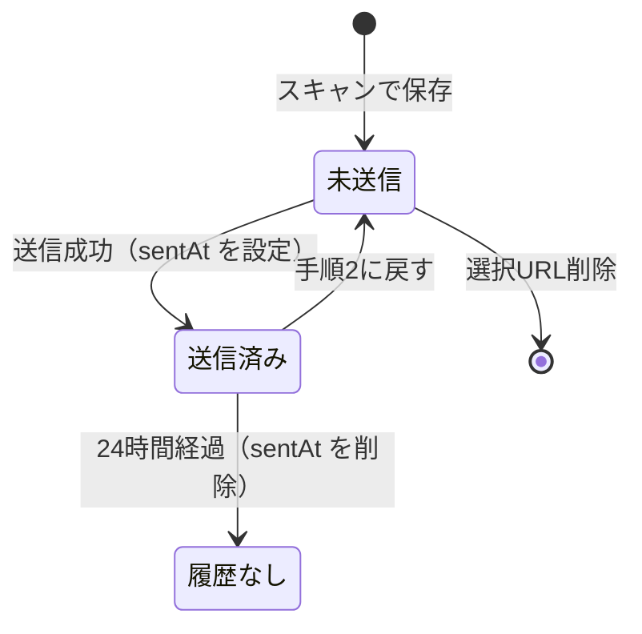
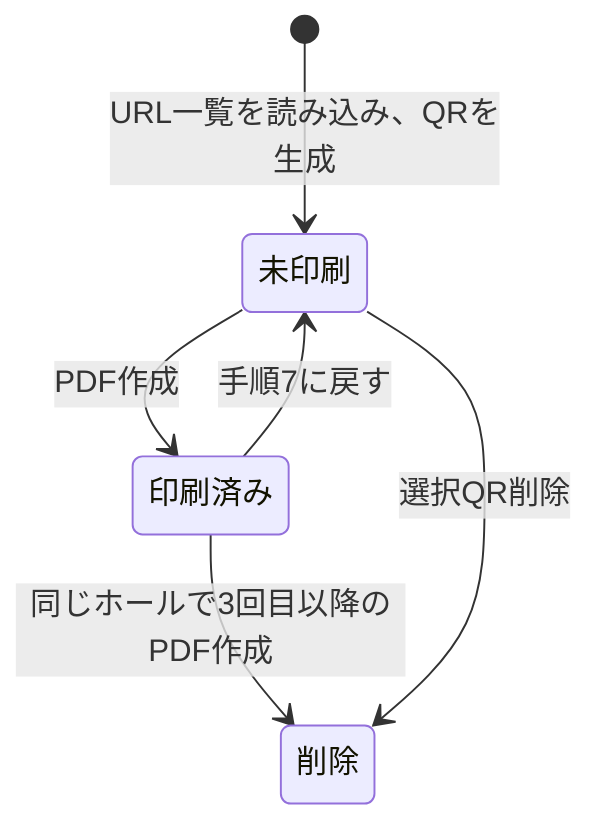

# データ設計

データの項目、保存先、ファイルや通信の形式をまとめた文書です。

- 機能・業務ルール：[SPECIFICATION.md](SPECIFICATION.md)
- 構成・データの流れ：[SYSTEM_OVERVIEW.md](SYSTEM_OVERVIEW.md)

## 1. 保存先

すべてのデータは、使っている端末のブラウザ内（localStorage）に保存します。サーバーには保存しません。

| キー | 内容 | 形式 |
|---|---|---|
| `logistics_v4_data` | QRコードの情報（QRレコードの配列） | JSON配列 |
| `logistics_v4_session` | スマホの手順2に表示しているURLの `id` の一覧 | JSON配列（文字列） |
| `logistics_v4_halls` | 本店名とホール名のリスト | JSON配列 |
| `logistics_v4_products` | 過去に付与した商品名（入力の候補） | JSON配列（文字列） |
| `logistics_v4_transfer` | GASのURL、転送トークン、送信先メールアドレス | JSONオブジェクト |

> キー名の `v4` は、初期の版から引き継いでいる名前です。アプリのバージョンとは関係ありません。名前を変えると既存のデータを読めなくなるため、そのままにしています。

### 端末間の関係

- スマホとPCのデータは、**自動では同期されません**。それぞれの端末のブラウザが、別々に持ちます。
- 同じ端末でも、ブラウザが違えば、別のデータになります。
- アプリのURL（オリジン）が変わると、別のアプリとして扱われ、データを引き継げません。

## 2. QRレコード

`logistics_v4_data` の配列の1要素が、QRコード1件です。

| 項目 | 型 | 内容 | 設定される場面 |
|---|---|---|---|
| `id` | 文字列 | 一意なID（UUID） | 登録時 |
| `qrKey` | 文字列 | 重複判定用のキー。`qr:` + URL | 登録時 |
| `url` | 文字列 | QRコードの内容（`http://` または `https://` のURL） | 登録時 |
| `image` | 文字列 | QRコード画像（PNGのData URL）。スマホで読み取った段階では空 | PCで生成したとき |
| `date` | 文字列 | 納品日（`YYYY-MM-DD`）。未設定は空 | 手順6 |
| `mainName` | 文字列 | 本店名。未設定は空 | 手順6 |
| `hall` | 文字列 | ホール名。未設定は空 | 手順6 |
| `product` | 文字列 | 商品名。未設定は空 | 手順6 |
| `status` | 文字列 | `unprinted`（未印刷）または `printed`（印刷済み） | 登録時、PDF作成時、差し戻し時 |
| `createdAt` | 文字列 | 登録した日時（ISO 8601）。PCでは、QRコードを生成した日時 | 登録時 |
| `scannedAt` | 文字列 | 読み取った日時（ISO 8601） | 登録時 |
| `sentAt` | 文字列 | メール送信に成功した日時（ISO 8601）。24時間後に削除 | 送信成功時 |
| `printedAt` | 文字列 | PDFを作成した日時（ISO 8601） | PDF作成時 |
| `printBatchId` | 文字列 | PDFを作成した回ごとのID | PDF作成時 |

### 例（PCで管理しているレコード）

```json
{
  "id": "0b8f6c1e-0000-4000-8000-000000000000",
  "qrKey": "qr:https://example.com/item/001",
  "url": "https://example.com/item/001",
  "image": "data:image/png;base64,iVBORw0KGgo…",
  "date": "2026-10-09",
  "mainName": "本店A",
  "hall": "ホールA1",
  "product": "サンプル商品",
  "status": "unprinted",
  "createdAt": "2026-10-08T07:11:48.000Z",
  "scannedAt": "2026-10-08T07:11:48.000Z"
}
```

## 3. 状態の遷移

### スマホ側（URLの送信）



- 「未送信」は、`logistics_v4_session` に `id` が入っている状態です。
- 「送信済み」は、`sentAt` が設定されている状態です。
- 「履歴なし」は、`sentAt` が消え、手順2にも手順4にも表示されない状態です。同じURLを再びスキャンすると、手順2に戻ります。

### PC側（QRコード）



## 4. ホールマスタ

`logistics_v4_halls` に、本店名とホール名の組を保存します。

```json
[
  { "main": "本店A", "hall": "ホールA1" },
  { "main": "本店A", "hall": "ホールA2" },
  { "main": "本店B", "hall": "ホールB1" }
]
```

設定画面では、1行に1組を、カンマ区切りで入力します。

```
本店A,ホールA1
本店A,ホールA2
本店B,ホールB1
```

| 規則 | 内容 |
|---|---|
| 区切り | 改行で1組ずつ分ける。カンマの前が本店名、後ろがホール名 |
| 空の行 | 無視する |
| 保存していない場合 | サンプルのリストを使う |
| 旧形式 | ホール名だけの文字列は、本店名「未分類」として読み込む |

## 5. URL一覧（TXTファイル）

スマホからPCへ、メールに添付して渡すファイルです。

| 項目 | 内容 |
|---|---|
| 文字コード | UTF-8 |
| 形式 | 1行に1URL |
| ファイル名 | `URL一覧_YYYY-MM-DD_HH-mm-ss.txt`（GASが送信時刻から付ける） |
| 読み込み時の扱い | 改行またはカンマで区切り、`http://` か `https://` で始まるものだけを使う。複数のファイルを同時に読み込める |

```
https://example.com/item/001
https://example.com/item/002
```

## 6. GASとの通信

### リクエスト

アプリからGASへ、`POST` で送ります。`Content-Type` は `text/plain;charset=utf-8` です。

```json
{
  "token": "転送トークン",
  "to": "送信先メールアドレス",
  "date": "2026-10-09",
  "batchId": "v6-1728450708000-1",
  "urls": ["https://example.com/item/001", "https://example.com/item/002"]
}
```

| 項目 | 内容 |
|---|---|
| `token` | `Code.gs` の `TRANSFER_TOKEN` と一致する必要がある |
| `to` | 送信先。空のときは `Code.gs` の `DEFAULT_TO` を使う |
| `date` | アプリ側の日付。メールの件名やファイル名には、GASが送信時刻から作った日時を使う |
| `batchId` | 送信の識別用。メール本文に記載される |
| `urls` | URLの配列。1回のリクエストは最大1,000件 |

### レスポンス

成功：

```json
{ "ok": true, "count": 2, "batchId": "v6-1728450708000-1", "version": "v6.0", "remainingQuota": 98 }
```

失敗：

```json
{ "ok": false, "error": "unauthorized" }
```

| `error` | 意味 |
|---|---|
| `empty request` | 本文が空 |
| `unauthorized` | トークンが一致しない |
| `invalid recipient` | 送信先の形式が正しくない |
| `no urls` | URLの配列が空 |
| `no valid URLs` | 有効なURLが1件もない |
| その他 | GAS内部のエラー内容（承認未完了など） |

### 接続テスト

`GET` で `Code.gs` のURLを開くと、`logistics-system v6.0 URL transfer endpoint is running.` が返ります。アプリはこの文字列で、接続と、GASのバージョンを確認します。

## 7. バックアップ

設定画面の「バックアップを書き出す」で、`logistics_v4_backup.json` を作ります。

```json
{
  "data": [ /* QRレコードの配列 */ ],
  "halls": [ /* ホールマスタ */ ],
  "products": [ /* 商品名の候補 */ ]
}
```

| 区分 | 内容 |
|---|---|
| 含まれる | QRレコード、ホールマスタ、商品名の候補 |
| 含まれない | GASのURL、転送トークン、送信先メールアドレス（秘密情報のため） |
| 読み込み時 | 含まれる項目を、現在のデータと置き換える |

## 8. QRコード画像の仕様

| 項目 | 内容 |
|---|---|
| ライブラリ | qrcode-generator |
| 型番 | 自動 |
| 誤り訂正レベル | M |
| 1セルの大きさ | 12px |
| 余白 | 4セル |
| 形式 | PNG（Data URL）。背景は白、セルは黒 |

URLが長いほど、セルの数が増え、画像の大きさとデータ量が増えます。

## 9. PDFの仕様

| 項目 | 内容 |
|---|---|
| 用紙 | A4縦 |
| 作り方 | ページごとに1240×1754pxの画像を描き、JPEG（品質0.95）として貼り付ける |
| ページ上部 | ホール名（太字52px）、納品日（太字42px）を中央に表示 |
| 配置 | 2列。4個のときは2行、6個のときは3行。各セルに枠を付ける |
| セルの内容 | QRコード画像、その下に商品名（未設定のときは「商品未設定」） |
| ページの分け方 | 納品日の古い順に並べ、納品日が変わるとき、またはページが埋まったときに、次のページへ移る |
| ファイル名 | `納品資料_ホール名_納品日.pdf` |

## 10. 保存容量の目安

localStorageには、ブラウザごとの上限（おおむね5MB前後）があります。QRコード画像（PNG）は、1件あたり数KBです。

| QRコードの大きさ（目安） | 1件あたり | 保存できる件数の目安 |
|---|---|---|
| セル数33×33（短いURL） | 約4KB | 1,000件前後 |
| セル数41×41（中くらいのURL） | 約5KB | 900件前後 |
| セル数49×49（長いURL） | 約7KB | 700件前後 |

実際の件数は、URLの長さや、ブラウザの実装によって変わります。目安として、**数百件を超えたら、印刷済みの整理とバックアップを行ってください**。スマホ側は画像を保存しないため、容量の心配はほとんどありません。

保存容量が上限を超えると、データを保存できなくなります。そのときは、不要なQRを削除してから、操作をやり直してください。
