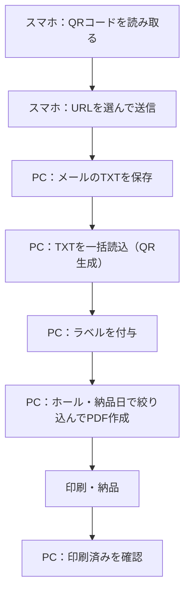

# 運用手順

日常の使い方、バックアップ、障害時の対応、データの復旧についてまとめた文書です。

- 導入・更新：[DEPLOYMENT.md](DEPLOYMENT.md)
- 仕様：[SPECIFICATION.md](SPECIFICATION.md)

## 1. 日常の運用

### 1.1 スマートフォン側

| 順番 | 作業 | ポイント |
|---|---|---|
| 1 | アプリを開く | ホーム画面のアイコンから起動する。画面上部に赤い警告が出ていないことを確認する |
| 2 | 「①」でスキャンを開始する | カメラを許可しておく。QRコードを枠の中に入れ、緑の枠と「保存しました」の表示を確認する |
| 3 | 読み取りを終えたら「停止」を押す | `読み取り完了：追加 〇件 / 重複 〇件 / 読み取り不可 〇件` で、件数を確認する |
| 4 | 手順2で、送信するURLを選ぶ | 通常は「全選択」を使う |
| 5 | 「URL送信」を押す | 「送信完了」の表示を確認する |
| 6 | 「②」で、送信したURLを確認する | 送信時刻が付いていることを確認する |

- 読み取り不可（URL以外のQR）は、保存されません。
- 同じQRコードを何度かざしても、重複しては登録されません。

### 1.2 PC側

| 順番 | 作業 | ポイント |
|---|---|---|
| 1 | メールの添付（TXT）を、PCに保存する | ファイル名に、送信日時が入っている |
| 2 | 「③」の手順5で、TXTを一括読込する | `読み込み完了：追加 〇件 / 重複 〇件 / 読み取り不可 〇件` を確認する |
| 3 | 手順6で、ラベルを付与する | 「未入力の項目で絞り込み」を使うと、付け忘れを探せる |
| 4 | 「④」で、ホール名と納品日を選ぶ | 表示されたQRを選び、「A4 PDF作成」を押す |
| 5 | PDFを印刷する | 印刷前に、ホール名・納品日・商品名・QRコードの読み取りを確認する |
| 6 | 「⑤」で、印刷済みを確認する | ホール別に表示される |

### 1.3 1日の流れの例

## 2. 定期的な作業

| 頻度 | 作業 | 内容 |
|---|---|---|
| 作業の終わりごと | 未送信のURLを確認 | スマホの手順2に、未送信のURLが残っていないか確認する |
| 週に1回など | バックアップ | PCで、設定の「バックアップを書き出す」を実行し、ファイルを安全な場所に保存する |
| 月に1回など | 件数の確認 | 「③」の件数を確認する。数百件を超えていたら、不要なQRを整理する |
| 不定期 | 動作の確認 | 「GAS接続テスト」を実行して、接続できることを確認する |
| 必要に応じて | トークンの変更 | [DEPLOYMENT.md](DEPLOYMENT.md) の「トークンを変更するとき」を参照 |

## 3. 自動で行われる整理

| 対象 | 内容 |
|---|---|
| スマホの送信済みURL | 送信から24時間たつと、「② 送信済み」の一覧から消える |
| PCの印刷済みQR | ホールごとに、直近2回のPDF作成分だけを残す。3回目のPDFを作成すると、いちばん古い回の印刷済みQRは完全に削除される |

> 印刷済みQRの削除は、取り消せません。古い回のQRをもう一度使う可能性があるときは、PDFを作成する前に、「⑤」からQRを手順7へ戻すか、バックアップを書き出してください。

## 4. バックアップと復元

### 4.1 書き出し

1. PCで、アプリの「⚙ 設定」を開く。
2. 「データ管理」の「バックアップを書き出す」を押す。
3. `logistics_v4_backup.json` が保存される。日付を付けて、保管する。

含まれるのは、QRコードの情報、本店名/ホールのリスト、商品名の候補です。GASのURL、転送トークン、送信先メールアドレスは含まれないため、別に控えておきます（共有しない、公開しない）。

### 4.2 復元

1. 新しい端末、またはデータが消えた端末で、アプリを開く。
2. 「⚙ 設定」で、GASのURL、転送トークン、送信先を入力し、保存する。
3. 「バックアップを読み込む」で、保存しておいたファイルを選ぶ。
4. 「③」「④」「⑤」で、データが戻っていることを確認する。

> 読み込むと、現在のデータは、バックアップの内容に置き換わります。

### 4.3 端末を入れ替えるとき

古い端末でバックアップを書き出し、新しい端末で復元します。スマホ側は、送信前のURLが残っていないことを確認してから、入れ替えてください。

## 5. 障害時の対応

| 症状 | 原因の候補 | 対処 |
|---|---|---|
| 画面上部に赤い警告が出る | 外部ライブラリを読み込めていない | 通信状態を確認し、「再読み込み」を押す |
| カメラが起動しない | カメラの許可がない。HTTPSで開いていない | ブラウザのカメラ許可を確認する。公開URL（https）で開く |
| QRコードを読み取れない | 暗い、ピントが合わない、QRが小さい | 明るい場所で、QRコードを枠いっぱいに写す。ライトや拡大を使う |
| 「URL以外のQRです」と出る | URL以外が入ったQRコード | 対象外のQRコード。保存されない |
| 送信に失敗する（トークン） | 転送トークンが、アプリとGASで違う | 両方を同じ文字列にそろえる |
| 送信に失敗する（承認） | GASの承認が未完了 | Apps Scriptで `authorizeOnce` を実行し、再デプロイする |
| 「GASから想定外の応答」 | アクセス権が「全員」でない。古いデプロイ | デプロイの設定を確認し、新しいバージョンで再デプロイする |
| 「応答を確認できませんでした」 | 通信が不安定、ブラウザの制限 | メールが届いたかを確認する。届いていなければ、「GAS接続テスト」を実行し、手順2から再送する。届いていれば、再送しない（二重に届く） |
| メールが届かない | 迷惑メールに入った。送信先の誤り。送信上限 | 迷惑メールフォルダと、送信先の設定を確認する。上限に達した場合は、翌日以降に再送する |
| GAS接続テストで「旧バージョン」 | `Code.gs` が古い | `Code.gs` を最新に貼り替え、新しいバージョンでデプロイする |
| TXTを読み込んでも追加されない | すべて登録済み、またはURLが含まれていない | 件数の表示（追加・重複・読み取り不可）を確認する |
| ホール名の候補が出ない | 先に本店名を選んでいない。リストが未登録 | 本店名を選ぶ。設定でホールのリストを保存する |
| 印刷対象が表示されない | ホール名が未選択。条件に合うQRがない | ホール名を選ぶ。納品日の絞り込みを「すべて」にする |
| データが保存されない | 保存容量の上限 | 不要なQRを削除する。バックアップ後に、印刷済みを整理する |
| 更新したのに画面が変わらない | キャッシュが古い | アプリを閉じて開き直す。解決しない場合は、バックアップのあと、サイトデータを消去する |

## 6. データが消えたとき

| 原因 | 復旧の方法 |
|---|---|
| ブラウザのサイトデータを消した | バックアップがあれば、復元する。なければ、メールの添付（TXT）から、URL一覧を読み込み直す（ラベルは、付け直す） |
| 端末の故障・紛失 | 別の端末で、設定を入力し直し、バックアップから復元する。トークンが漏れた可能性があるときは、トークンを変更する |
| 誤って「全データ削除」を押した | バックアップから復元する。なければ、メールの添付（TXT）から、読み込み直す |
| 誤って印刷済みが自動削除された | バックアップから復元する。なければ、メールの添付（TXT）から、QRコードを再生成する |

> URLさえ残っていれば、QRコード画像は何度でも作り直せます。メールに届いたTXTは、削除せずに保管しておくと、復旧に役立ちます。

## 7. メールの送信上限

GASから送れるメールの数には、Google側で1日あたりの上限があります。上限は、アカウントの種類によって異なり、Googleの都合で変わることがあります。無料のGmailアカウントでは、受信者の数で、1日あたり100人程度が目安です。

- 1回の送信で、複数のURLをまとめて送れます（1通に最大1,000件）。
- 1日に何度も送らず、ある程度まとめて送ると、上限に達しにくくなります。
- 送信後のGASの応答には、残りの送信可能数（`remainingQuota`）が含まれます。

最新の上限は、Googleの公式ドキュメント「Apps Script の割り当て」で確認してください。

## 8. セキュリティ上の注意

| 内容 | 対応 |
|---|---|
| 転送トークンの管理 | 他人に共有しない。チャットやメールに書かない |
| 共有端末 | 使い終わったら、設定の「全データ削除」で、トークンとデータを消す |
| 端末の紛失 | 画面ロックを設定しておく。紛失したら、トークンを変更する |
| 公開リポジトリ | トークン、メールアドレス、GASのURLを、書かない |
| 不審なメールが届いた | 身に覚えのない送信があれば、トークンを直ちに変更する |

## 9. 問い合わせ・記録

障害が起きたときは、次の情報を控えておくと、原因を調べやすくなります。

- 発生した日時、操作していた画面（①〜⑤、設定）
- 端末とブラウザの種類（例：Android Chrome、iPhone Safari、PC Chrome）
- 画面に表示されたメッセージ
- 「GAS接続テスト」の結果
