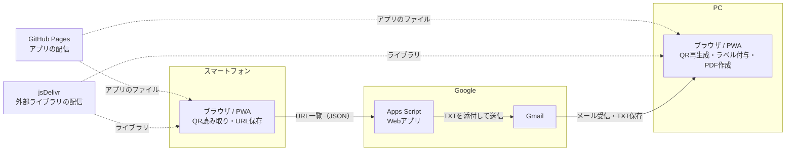
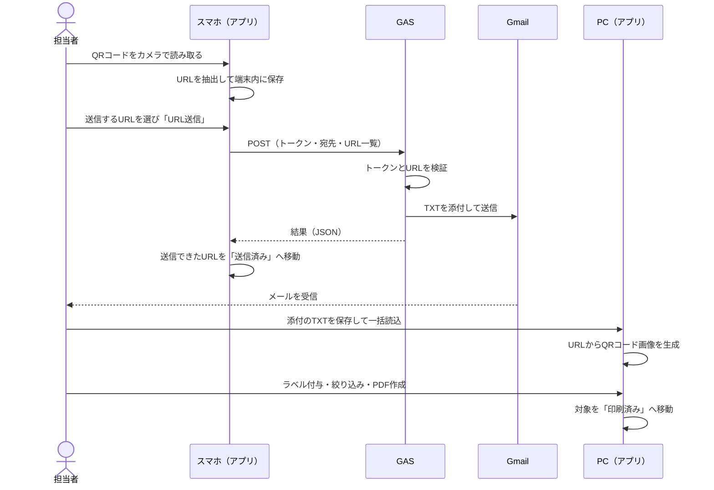

# システム概要

本システムの構成、データの流れ、設計方針をまとめた文書です。

- 機能・画面・業務ルールの詳細：[SPECIFICATION.md](SPECIFICATION.md)
- データ項目・保存先・形式：[DATA_DESIGN.md](DATA_DESIGN.md)

## 1. 目的

納品作業で使うQRコードを、次の流れで扱えるようにします。

1. スマートフォンでQRコードを連続して読み取る
2. 読み取ったURLを、メールでPCへ送る
3. PCでURLからQRコード画像を作り直す
4. 納品日・本店名・ホール名・商品名を付ける
5. 対象を絞り込み、A4のPDFで印刷する

専用のサーバーやデータベースは使いません。ブラウザで動くWebアプリと、メール送信用のGoogle Apps Script（GAS）だけで動きます。

## 2. システム構成

### 構成要素

| 要素 | 役割 | 実体 |
|---|---|---|
| Webアプリ本体 | 画面、QR読み取り、データ管理、PDF作成のすべて | `index.html` |
| サービスワーカー | アプリ本体と外部ライブラリのキャッシュ | `sw.js` |
| PWA設定 | ホーム画面に追加するための情報 | `manifest.webmanifest`、`icon-*.png` |
| メール送信用GAS | URL一覧を受け取り、TXTを添付してGmailで送る | `Code.gs`（Google側に配置） |
| GitHub Pages | HTTPSで静的ファイルを配信する | このリポジトリ |
| jsDelivr | 外部ライブラリ3つを配信する | 外部サービス |
| ブラウザ内の保存領域 | 読み取ったURL、QRの情報、設定を保存する | localStorage |

### 使用ライブラリ

| ライブラリ | バージョン | 用途 |
|---|---|---|
| jsQR | 1.4.0 | QRコードの読み取り（標準の検出機能が使えない端末） |
| jsPDF | 2.5.1 | PDFの作成 |
| qrcode-generator | 1.4.4 | QRコード画像の生成 |

QRコードの読み取りは、ブラウザに標準の検出機能（BarcodeDetector）があればそれを使い、なければ jsQR を使います。

## 3. データの流れ

### 転送するもの、しないもの

| 区分 | 内容 |
|---|---|
| 転送する | URL一覧（テキスト）。1行に1URLのTXTファイルでメールに添付される |
| 転送しない | QRコード画像、納品日・本店名・ホール名・商品名などのラベル情報 |

QRコード画像は、URLから何度でも同じものを作り直せます。画像を送らないことで、メールの容量と、送信にかかる時間を小さくしています。

## 4. 画面構成

| メニュー | 主な利用者の端末 | 内容 |
|---|---|---|
| ① QRコード読取 / URL送信 | スマートフォン | 読み取り、URL確認、メール送信（手順1〜3） |
| ② 送信済み | スマートフォン | 送信済みURLの確認と、手順2への差し戻し（手順4） |
| ③ QRコード生成 / ラベル付与 | PC | TXTの読み込み、QR生成、ラベル付与（手順5〜6） |
| ④ 印刷準備 | PC | 絞り込みと選択、PDF作成（手順7） |
| ⑤ 印刷済み | PC | ホール別の確認、手順7への差し戻し（手順8） |
| ⚙ 設定 | 共通 | GAS・送信先、本店名/ホールリスト、バックアップ |

どの画面も、スマートフォンとPCのどちらでも開けます。表の「主な利用者の端末」は、想定する使い方です。

## 5. 設計方針

| 方針 | 内容 |
|---|---|
| サーバーレス | サーバーやデータベースを持たず、運用と費用を最小にする |
| 端末内で完結 | データは各端末のブラウザ内に保存し、外部へ送るのはURL一覧だけにする |
| URLだけを転送 | 画像を送らず、PC側で再生成する |
| 結果を確認して反映 | GASの応答を確認できたURLだけを「送信済み」にする |
| 履歴の自動整理 | 送信済みは24時間、印刷済みはホールごとに直近2回分のPDFまで保持する |
| 表示範囲だけを操作 | 絞り込み中は、画面に表示されているQRだけを選択・付与・削除の対象にする |
| 部品の読み込み失敗を通知 | 外部ライブラリを読み込めないときは、画面に警告を出して、該当する機能を止める |

## 6. セキュリティの考え方

| 項目 | 内容 |
|---|---|
| 転送トークン | アプリとGASで同じ文字列を共有する合言葉。GASのWebアプリは「全員」がアクセスできる設定のため、トークンが唯一の認証になる |
| トークンの保存場所 | `Code.gs` はGoogle側、アプリの設定は各端末のブラウザ内。**リポジトリには入れない** |
| 公開してよいもの | このリポジトリのファイル。`Code.gs` はダミー値のまま公開する |
| 公開してはいけないもの | 転送トークン、送信先メールアドレス、GASのウェブアプリURL、実際の取引先名・店舗名 |
| 通信 | アプリの配信とGASへの送信は、HTTPSで行う |
| ブラウザ内のデータ | 暗号化していない。端末の画面ロックと、共有端末でのブラウザ利用に注意する |

### 既知の制約

| 制約 | 影響 | 対策 |
|---|---|---|
| 送信先アドレスをアプリ側から指定できる | トークンが漏れると、第三者が任意の宛先へメールを送れる | トークンを共有しない。漏れた場合は、直ちにトークンを変更する。送信先を固定したい場合は、`Code.gs` で `DEFAULT_TO` だけを使うように変更する |
| トークンがブラウザ内に平文で保存される | 端末を共有すると、他の人が見られる | 共有端末では使わない。使った後は、設定画面の「全データ削除」を使う |
| メールの送信回数に上限がある | 上限を超えると送信に失敗する | 運用では、1日の送信回数をまとめる（[OPERATIONS.md](OPERATIONS.md)） |

## 7. 動作環境

| 項目 | 内容 |
|---|---|
| ブラウザ | 最近のChrome、Safari、Edgeなど |
| カメラ | HTTPSで開いたページで、カメラの使用を許可する必要がある |
| 通信 | 初回の読み込みと、GASへの送信に必要。ライブラリはキャッシュされる |
| 保存領域 | ブラウザのlocalStorage。容量に上限がある（[DATA_DESIGN.md](DATA_DESIGN.md)） |

## 8. 制約と今後の検討事項

- データは端末ごとに独立しており、自動では同期されない。端末間の移動には、バックアップの書き出しと読み込みを使う
- QR画像もブラウザ内に保存するため、件数が増えると容量の上限に近づく
- 画像はURLから再生成できるので、保存を省いて容量を抑える方法も考えられる
